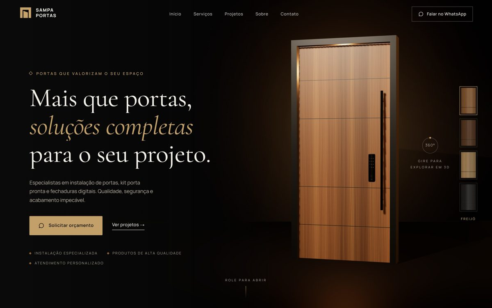
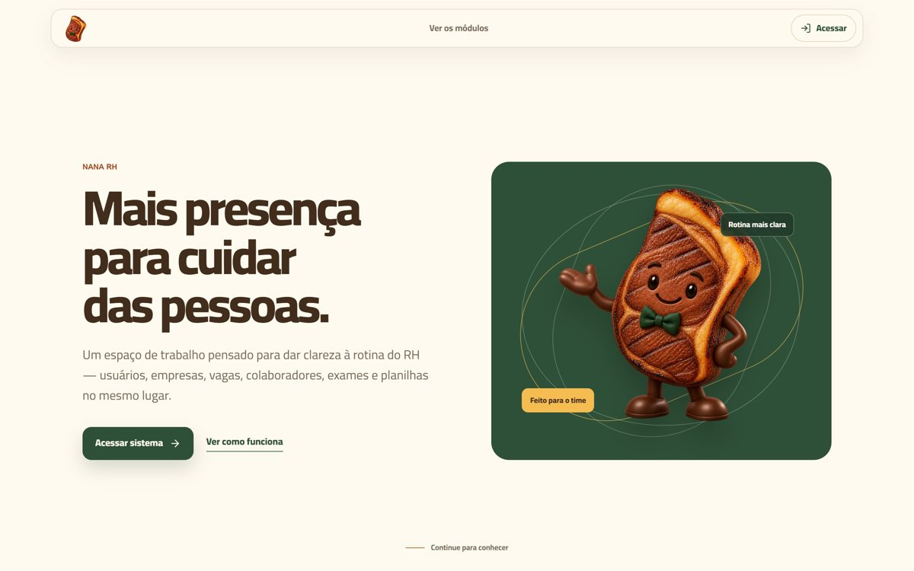

<!-- Perfil do GitHub de ryxnandrade, versão pessoal (23/11/2026): a pessoa vem primeiro e a RYXN aparece como o estúdio do Ryan.
     Banner e prints dos cases ficam em assets/; a cobrinha é gerada pelo workflow em .github/workflows/snake.yml na branch "output". -->

  

  

  
  
  
  

---

## Sobre mim

Oi, eu sou o **Ryan** 👋

Sou arquiteto de software. Meu dia a dia é com ERP e a parte fiscal que vem junto: NF-e, NFC-e, substituição tributária e, agora, a reforma tributária. Foi ali que aprendi a respeitar regra de negócio, dado de verdade e usuário com pressa.

Gosto de levar esse cuidado para o outro lado da tela também: interface bem feita, movimento que tem motivo e app ou site que roda rápido no celular.

Hoje ando bastante por:

- 🧱 **Sistemas e ERP**: Java, Spring, PostgreSQL, regras fiscais e as integrações que ninguém vê, mas todo mundo usa.
- 📱 **Aplicativos**: Flutter, Android (Kotlin) e iOS (Swift).
- ✨ **Sites com movimento**: React, Astro, GSAP e Three.js para sites que as pessoas lembram.
- 🎬 **Vídeos e 3D com código**: Remotion, HyperFrames e React Three Fiber, com voz e trilha geradas por IA.
- 🤖 **IA e agentes**: automatizando o que é repetitivo e usando agentes no meu próprio fluxo de desenvolvimento.

> O problema orienta o produto. A tecnologia segue o contexto.

---

## Meu estúdio: RYXN

Fora do trabalho, toco a **[RYXN](https://ryxn.com.br)**, um estúdio pequeno, de contato direto, onde faço sites, aplicativos, sistemas sob medida, identidade visual, vídeos e soluções com IA. Alguns trabalhos:

<table>
  <tr>
    <td width="50%" valign="top">
      
      <h3><a href="https://ryxn.com.br/projetos/sampa-portas">Sampa Portas</a></h3>
      
Site institucional com uma porta em 3D que gira 360° e se abre conforme a rolagem, revelando a luz do outro lado.

      

        
        
        
      

      
<a href="https://ryxn.com.br/projetos/sampa-portas">Ver case →</a> · <a href="https://sampaportas.pages.dev">Abrir o site →</a>

    </td>
    <td width="50%" valign="top">
      
      <h3><a href="https://ryxn.com.br/projetos/nana-rh">NANA RH</a></h3>
      
O RH inteiro num só lugar: vagas, entrevistas, colaboradores e exames, num sistema feito sob medida para a rotina da empresa.

      

        
        
        
      

      
<a href="https://ryxn.com.br/projetos/nana-rh">Ver case →</a>

    </td>
  </tr>
</table>

<a href="https://github.com/ryxnandrade/Portifolio">O código do site da RYXN está aqui (Astro + GSAP)</a>

---

## Com o que eu trabalho

### 🧱 Back-end e dados

### 🖥️ Front-end

  
  
  
  
  
  

### 📱 Aplicativos

  
  
  
  
  
  

### 🎬 Vídeos, 3D e IA

  
  
  
  
  
  
  
  
  

### 🛠️ Ferramentas

  
  
  
  
  

### 📚 Domínio de negócio

  
  
  
  
  
  
  

---

## Por aqui no GitHub

<!-- Cards de estatística e linguagens escondidos em 23/11/2026: só contam repositórios públicos e hoje mostram tudo zerado.
     Tirar este comentário quando houver repositórios públicos com código.

  
  

-->

  

  <picture>
    <source media="(prefers-color-scheme: dark)" srcset="https://raw.githubusercontent.com/ryxnandrade/ryxnandrade/output/github-snake-dark.svg">
    
  </picture>

---

  Quer trocar uma ideia sobre código, IA ou um projeto? Me chama no <a href="https://www.linkedin.com/in/ryanandradedejesus/">LinkedIn</a> ou por <a href="mailto:ryan.andradejesus07@gmail.com">e-mail</a>. 
  Projeto para a sua empresa? É pela <a href="https://ryxn.com.br/#contato">RYXN</a>.

  

